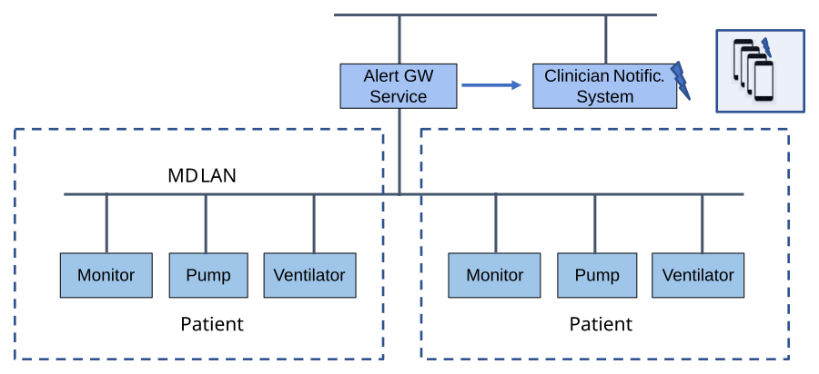

[#clause_use_case_spoc,sdpi_offset=7]
[role=use-case,use-case-id=spoc,sdpi_feature="Silent Point-of-Care",oid-arcs=".7"]
== Use Case Feature {var_use_case_id}: <<label_use_case_name_spoc>> (<<acronym_spoc>>)

=== Narrative

#ADD USE CASE NARRATIVE#

=== Benefits

#ADD BENEFITS LIST#

=== Technical View
#UPDATE GRAPHIC TO SPOC#

.<<label_use_case_name_spoc>> (<<acronym_spoc>>) -- Technical View

[#clause_use_case_spoc_technical_precondition]
=== Technical Pre-Conditions

[role=use-case-background]
====
*Given* ...

*And* ...
====

[#clause_use_case_spoc_scenarios]
=== Scenarios

[role=use-case-scenario,sdpi_scenario="SPoC Scenario Name"]
[oid-arcs=".1"]
==== Scenario: <<acronym_spoc>> {var_use_case_id}.1 - SPoC Scenario Label

[role=use-case-steps]
====
*Given* ...

*When* ...

*Then* ...
====

