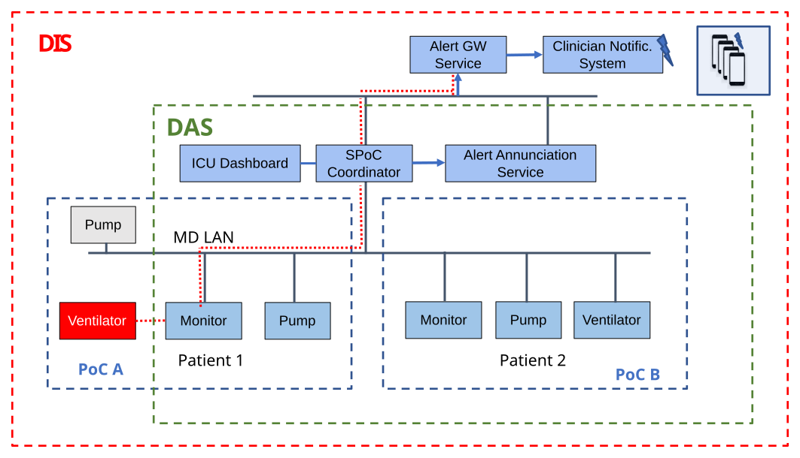

[#clause_use_case_spoc,sdpi_offset=7]
[role=use-case,use-case-id=spoc,sdpi_feature="Silent Point-of-Care",oid-arcs=".7"]
== Use Case Feature {var_use_case_id}: <<label_use_case_name_spoc>> (<<acronym_spoc>>)

=== Narrative

In the ICU, Nurse Maya Chen is monitoring Mr. Alvarez, who is mechanically ventilated and connected to several infusion pumps and a patient monitor. While there is no clinician in the ICU, the device alarms are coordinated through a Distributed Alarm System (DAS) and made available at the central station, allowing Maya to monitor them without being in the room. Beyond announcing alarms (though an ICU Dashboard or an Alert Annunciation Service), the central station also coordinates the Silent Point of Care (SPoC). To reduce noise around Mr. Alvarez, Maya activates Silent PoC mode at the central station. Consequently, the devices mute their local auditory alarm signals while alarms continue to be announced through the central station.

=== Benefits

By muting auditory alarms at the bedside while retaining central annunciation, Silent PoC can reduce disruptive auditory input around the patient. This may help support sleep and a stable day–night rhythm, lower stress and anxiety, reduce the risk of delirium, and potentially support faster recovery.

For clinical users, remote annunciation of alarms at the clinician's location can help them review and prioritize alarm conditions across patients without first visiting each patient room. This may improve alarm visibility and management, reduce workload and mental fatigue, and support communication among the care team.

=== Technical View

.<<label_use_case_name_spoc>> (<<acronym_spoc>>) -- Technical View

[#clause_use_case_spoc_technical_precondition]
=== Technical Pre-Conditions

[role=use-case-background]
====
*Given* All devices communicate using a common <<acronym_md_lan>> protocol

*And* At least one SPoC Coordinator is connected to the <<acronym_md_lan>>

*And* All connected devices support Distributed Alarm System (DAS) and Silent PoC mode functionality
====

[#clause_use_case_spoc_scenarios]
=== Scenarios

[role=use-case-scenario,sdpi_scenario="Connect PoC device(s) to a DAS"]
[oid-arcs=".1"]
==== Scenario: <<acronym_spoc>> {var_use_case_id}.1 - Connect PoC device(s) to a DAS

[role=use-case-steps]
====
*Given* Device(s) is / are not in a DAS

*When* A clinical user enables the DAS at the SPoC Coordinator

*Then* SPoC Coordinator establishes a DAS for connected device(s)
====

[role=use-case-scenario,sdpi_scenario="Place a PoC in Silent Mode - No Active Alarms"]
[oid-arcs=".2"]
==== Scenario: <<acronym_spoc>> {var_use_case_id}.2 - Place a PoC in Silent Mode - No Active Alarms

[role=use-case-steps]
====
*Given* A DAS has been established and Silent PoC mode is allowed at the device(s)

*Given* The device(s) has / have NOT not detected an alarm condition

*When* The clinical user initiates Silent PoC mode at the SPoC Coordinator  

*Then* The device(s) enable(s) Silent PoC mode, thereby muting local annunciation of auditory alarm signals

*When* An alarm is detected at the device(s)

*Then* The SPoC Coordinator annunciates the auditory alarm signal through an Alert Annunciation Service and / or ICU Dashboard

*Then* The device(s) remains quiet
====

[role=use-case-scenario,sdpi_scenario="Place a PoC in Silent Mode - Alarms Already Active"]
[oid-arcs=".3"]
==== Scenario: <<acronym_spoc>> {var_use_case_id}.3 - Place a PoC in Silent Mode - Alarms Already Active

[role=use-case-steps]
====
*Given* A DAS has been established and Silent PoC mode is allowed at the device(s)

*Given* The device(s) has / have detected an alarm condition

*When* The clinical user initiates Silent PoC mode at the SPoC Coordinator  

*Then*  The SPoC Coordinator annunciates the alarm signal through an Alert Annunciation Service and / or ICU Dashboard, before the device(s) is / are put into Silent PoC mode

*Then* The device(s) enable(s) Silent PoC mode, thereby muting local annunciation of auditory alarm signals

*When* An alarm is detected at the device(s)

*Then* The SPoC Coordinator annunciates the auditory alarm signal through an Alert Annunciation Service and / or ICU Dashboard

*Then* The device(s) remains quiet
====

[role=use-case-scenario,sdpi_scenario="Graceful termination of DAS"]
[oid-arcs=".4"]
==== Scenario: <<acronym_spoc>> {var_use_case_id}.4 - Graceful termination of DAS

[role=use-case-steps]
====
*Given* A DAS has been established, wether or not in Silent PoC mode

*When* A clinical user disables the DAS at the SPoC Coordinator or at the device(s)

*Then* The DAS is gracefully terminated, and the device(s) regain(s) full responsibility for local alarm annunciation
====

[role=use-case-scenario,sdpi_scenario="Uncontrolled termination of DAS"]
[oid-arcs=".5"]
==== Scenario: <<acronym_spoc>> {var_use_case_id}.5 - Uncontrolled termination of DAS

[role=use-case-steps]
====
*Given* A DAS has been established, wether or not in Silent PoC mode

*When* Either a device or the SPoC Coordinator detect a technical failure that disrupts the DAS function of guaranteeing delivery of alarms with technical confirmation

*Then* The DAS is regarded as terminated, and the device(s) regain(s) full responsibility for local alarm annunciation
====

[role=use-case-scenario,sdpi_scenario="Coordinate Mixed DIS-DAS PoC Ecosystem"]
[oid-arcs=".6"]
==== Scenario: <<acronym_spoc>> {var_use_case_id}.6 - Coordinate Mixed DIS-DAS PoC Ecosystem

#This scenario needs review, since there is no defined way of coordinating a mixed DIS-DAS PoC ecosystem. It could be either removed (with simplification of the SPoC diagram) or changed to describe a mere coexistence of DIS and DAS or...#

[role=use-case-steps]
====
*Given* ...

*When* ...

*Then* ...
====

#OPEN QUESTION: Should there also be a scenario for Silent PoC with local deactivation and re-activation (Use case D.1.6 in A-PKP draft)?#