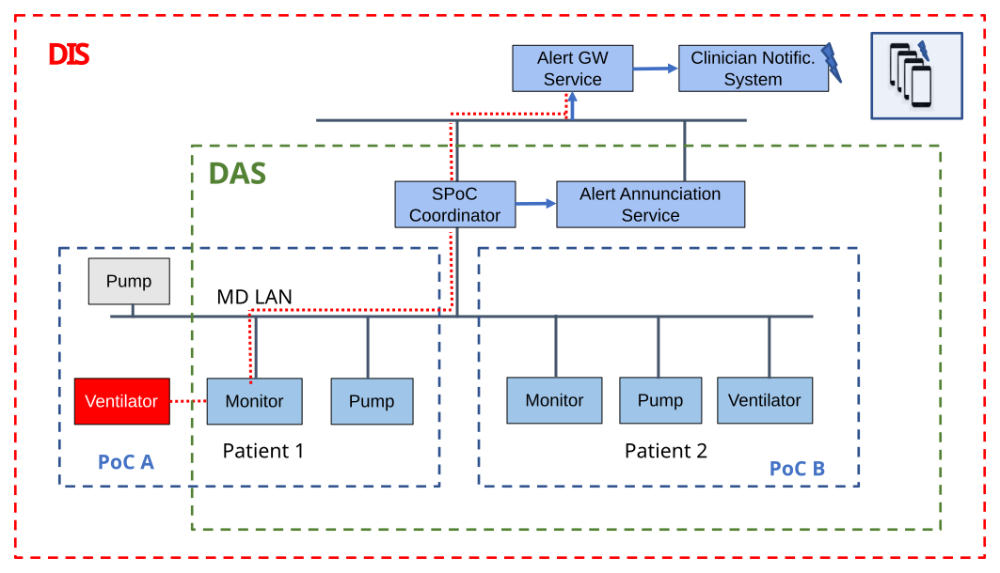

[#clause_use_case_spoc,sdpi_offset=7]
[role=use-case,use-case-id=spoc,sdpi_feature="Silent Point-of-Care",oid-arcs=".7"]
== Use Case Feature {var_use_case_id}: <<label_use_case_name_spoc>> (<<acronym_spoc>>)

=== Narrative

#ADD USE CASE NARRATIVE#

=== Benefits

#ADD BENEFITS LIST#

=== Technical View
#UPDATE GRAPHIC TO SPOC#

.<<label_use_case_name_spoc>> (<<acronym_spoc>>) -- Technical View

[#clause_use_case_spoc_technical_precondition]
=== Technical Pre-Conditions

[role=use-case-background]
====
*Given* All devices communicate using a common MD LAN protocol

*And* At least one DAS Manager is connected to the MD LAN

*And* All connected devices support Silent PoC Mode functionality
====

[#clause_use_case_spoc_scenarios]
=== Scenarios

[role=use-case-scenario,sdpi_scenario="Connect PoC devices to a DAS"]
[oid-arcs=".1"]
==== Scenario: <<acronym_spoc>> {var_use_case_id}.1 - Connect PoC devices to a DAS

[role=use-case-steps]
====
*Given* ...

*When* ...

*Then* ...
====

[role=use-case-scenario,sdpi_scenario="Establish a DAS for a Newly Connected Device"]
[oid-arcs=".2"]
==== Scenario: <<acronym_spoc>> {var_use_case_id}.2 - Establish a DAS for a Newly Connected Device

[role=use-case-steps]
====
*Given* ...

*When* ...

*Then* ...
====

[role=use-case-scenario,sdpi_scenario="Place a PoC in Silent Mode - No Active Alarms"]
[oid-arcs=".3"]
==== Scenario: <<acronym_spoc>> {var_use_case_id}.3 - Place a PoC in Silent Mode - No Active Alarms

[role=use-case-steps]
====
*Given* ...

*When* ...

*Then* ...
====

[role=use-case-scenario,sdpi_scenario="Place a PoC in Silent Mode - Alarms Already Active"]
[oid-arcs=".4"]
==== Scenario: <<acronym_spoc>> {var_use_case_id}.4 - Place a PoC in Silent Mode - Alarms Already Active

[role=use-case-steps]
====
*Given* ...

*When* ...

*Then* ...
====

[role=use-case-scenario,sdpi_scenario="Establish Primary and Backup DAS Coordinators"]
[oid-arcs=".5"]
==== Scenario: <<acronym_spoc>> {var_use_case_id}.5 - Establish Primary and Backup DAS Coordinators

[role=use-case-steps]
====
*Given* ...

*When* ...

*Then* ...
====
